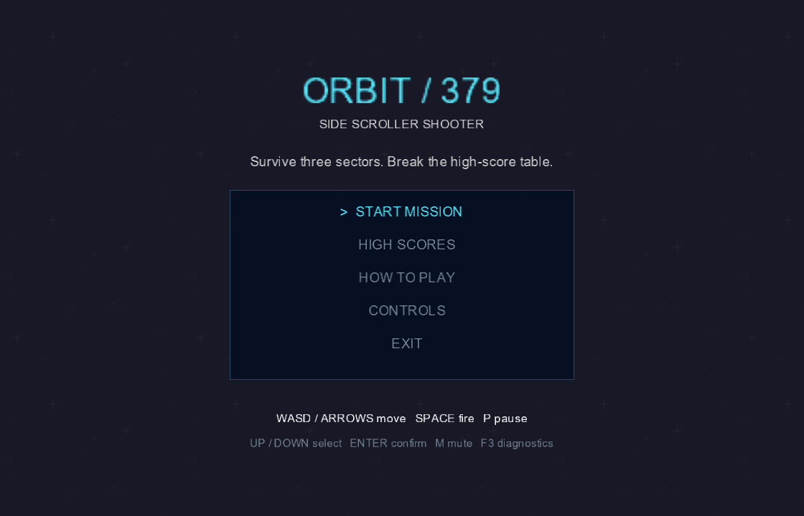

# SideScrollerShooter — ORBIT / 379

A C# / MonoGame DesktopGL space shooter with a three-sector campaign, event-driven input and scoring, configurable enemy formations, state-pattern enemy behaviour, animated thrusters, three pickup effects, and a persistent top-ten leaderboard.

Originally developed for a Computer Games Architecture university project. This revision strengthens the implementation and includes reproducible tests and explanations of the actual code.



## Play

Install the .NET 8 SDK. Windows and Arial are required for the verified build; other operating systems have not been tested. Open `SideScrollerShooter.sln` in Visual Studio with .NET 8 support, or run these commands from the repository root:

```powershell
dotnet tool restore
dotnet build SideScrollerShooter.sln -c Release
dotnet run --project SideScrollerShooter.csproj -c Release --no-build
```

The initial restore needs internet access. Both MonoGame package references are pinned to `3.8.4.1`; the local content tools use `3.8.4`. Original textures, audio, fonts and configuration are included. Generated content and build outputs are ignored.

| Action | Input |
| --- | --- |
| Move | WASD / arrow keys |
| Fire | Hold Space |
| Pause / resume | P |
| Return to menu | Escape |
| Mute music and effects | M |
| Show collision boxes, enemy states and timings | F3 |
| Select a menu item | Up/Down or W/S, then Enter |
| Save a run | Type a pilot name, then Enter |
| Retry / view records after saving | R / H |

Survive three sectors lasting 30, 35 and 40 seconds. Destroy white scouts, orange weavers and purple hunters for 100, 150 and 200 points. Pickups cycle through rapid fire (`R`), shield (`S`), and repair (`+`). The mission ends when all lives are lost or the final sector is completed.

## Configuration

`Config/world.json` controls the viewport, seed, player position/speed/lives, bullet speed, pickup timings, and every sector's duration, enemy pattern, spawn interval, speed and initial placements. Loading validates values and identifies invalid configurations immediately. The screen layout supports 1120–1920 by 720–1080.

`Config/tieredDifficulty.json` is retained from the original submission for reference. The upgraded game uses `world.json`; changing the legacy file has no runtime effect.

The score table is genuine JSON containing up to ten named entries, scores, sectors and UTC timestamps. It is stored outside the repository in `%LOCALAPPDATA%/SideScrollerShooter/highscores.json`. `SIDESCROLLERSHOOTER_DATA` can select another save directory.

## Verify

```powershell
dotnet run --project Tests/SideScrollerShooter.Tests.csproj -c Release
dotnet run --project Tests/SideScrollerShooter.Tests.csproj -c Release -- --benchmark
dotnet run --project SideScrollerShooter.csproj -c Release -- --smoke-test
```

The console regression runner returns a nonzero exit code on failure. The optional graphics smoke test uses synthetic input, isolated scores and a continuously refreshed shield to exercise the entire campaign quickly; it captures real rendered frames and closes automatically. It verifies integration, not game difficulty or human playability. Outputs go beneath the executable directory in `smoke-output/`.

## Design and evidence

- [Implementation walkthrough](docs/Architecture.md): all twelve game criteria, data flow, state transitions, lifetime and collision geometry.
- [User guide](docs/User-guide.md): complete instructions and tuning advice.
- [Performance study](docs/Performance.md): measured allocation experiment, hardware implications and remaining work.
- [Validation](docs/Testing.md): regression and graphics tests, their scope and limitations.
- [Asset provenance](docs/Assets.md): generated additions and unresolved attribution for inherited assets.


## Limits

This is a local single-player game with brute-force AABB collisions, not pixel-perfect or swept hit detection. Pause is supported; campaign checkpoint saves and networking are not implemented. Human balance testing, audible music/mute checks, varied hardware tests and cross-platform validation remain useful follow-up work. No particular assessment mark is claimed.

No software license has been selected. Redistribution rights for inherited art, audio and icon assets still need confirmation before public publication. No report, grading spreadsheet, student ID or personal coursework cover page is included in this project.
