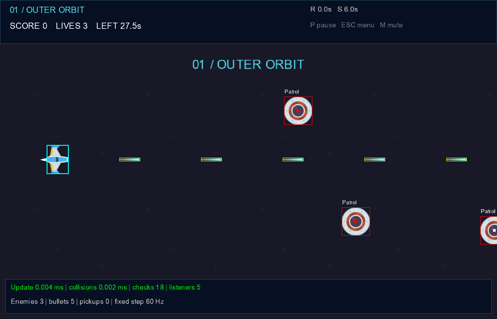
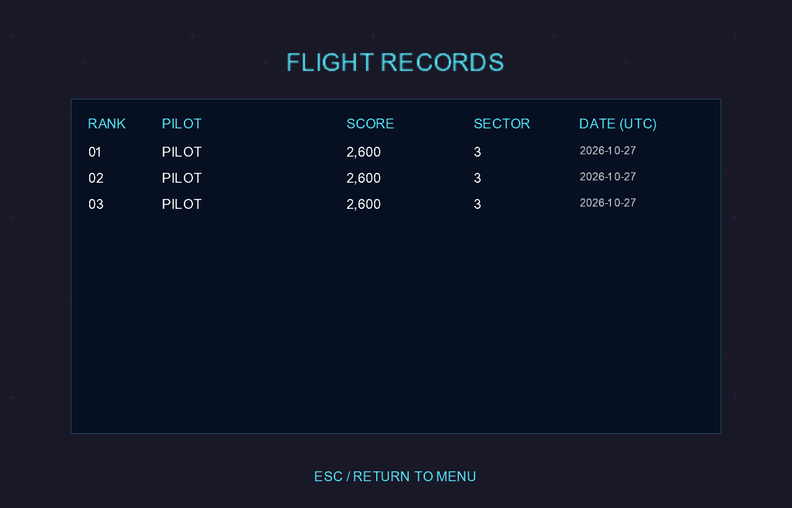
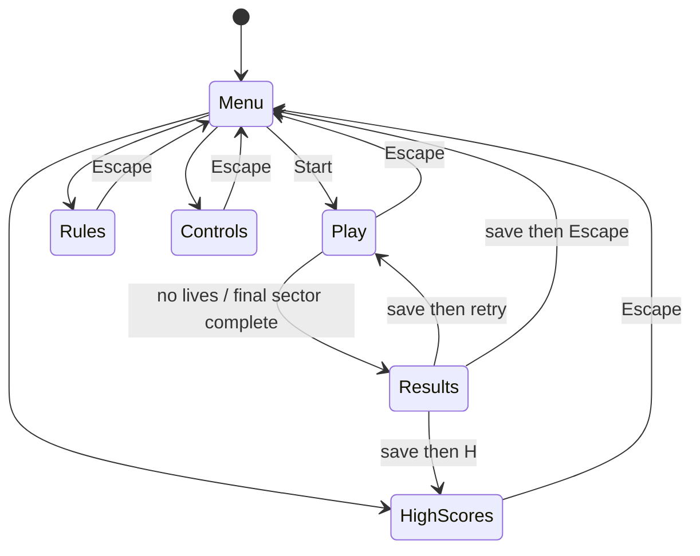
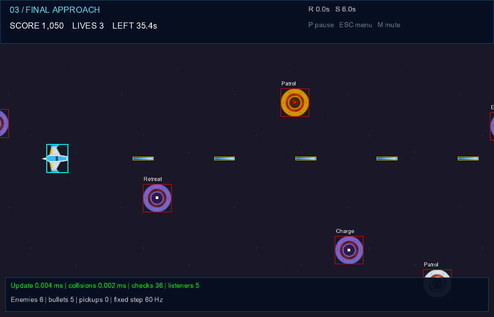

# Game architecture

This guide explains the game loop, engine services and gameplay systems in SideScrollerShooter. All code paths are relative to the project root.

## 1. Resource management and audio

`Game1.LoadContent` supplies MonoGame's `ContentManager` to `ResourceManager`, `FontManager` and `AudioManager`. `ResourceManager.LoadTexture` keeps a name-to-texture dictionary; repeated enemy creation reuses the same texture reference. `FontManager` does the same for sprite fonts. Audio is owned by `AudioManager`, which loads each effect once and owns a single looped `SoundEffectInstance` for the original eight-second `orbit_theme.wav` music bed.

These are deliberately separate caches: the texture manager does not also cache sounds and fonts. The content pipeline listed in `Content/Content.mgcb` builds five original textures, two original effects, the Arial sprite-font definition, and the new music loop. MonoGame's content manager owns loaded assets. `AudioManager.Dispose` releases its music instance; `Ui.Dispose` releases runtime-created pixel and animation textures. The program does not repeatedly load or dispose shared textures while switching scenes.

The music uses a looped sound-effect instance instead of streamed `Song` playback. At eight seconds and approximately 353 KB of PCM data, keeping it in memory is a reasonable small-game trade-off. A longer soundtrack would justify streaming. `M` mutes both effects and music. Audio-device absence is reported on the menu.

## 2. Event-driven input

`InputManager.Update` samples keyboard state once per game update and preserves the previous sample for edge detection. Menus use `Pressed` so holding Enter cannot repeatedly start games. During gameplay, `PublishGameplay` converts physical keys to the semantic `Input_Move` vector and `Input_Shoot` action. Diagonal input is normalized, avoiding a square-root-of-two speed advantage.

`Player` subscribes to these semantic events; it does not read the keyboard. It accumulates the requested movement and firing action, applies them in `Update(dt)`, then resets them. This separates hardware sampling from the responding object. The test-only keyboard provider injects scripted samples through the same input layer.

`EventManager.Subscribe` returns an `IDisposable` token. `Player`, `SpawnManager` and `ScoreManager` retain and dispose their tokens on `PlayState.Exit`. Dispatch iterates a snapshot of handlers, allowing safe unsubscription during an event. The bus is single-threaded; it is not intended for cross-thread publication. There are five live gameplay subscriptions and zero after returning to the menu. Tests repeat session creation 100 times to check cleanup.

## 3. Collision geometry and brute-force detection

Every `BaseEntity.Position` is the sprite's centre. `Draw` supplies the texture centre as origin and uses the same rotation and scale as `Bounds`. Keeping these transforms consistent aligns the collision rectangles with the rendered sprites.

For texture dimensions `w,h`, rotation `r` and scale `s`, `Geometry.Extents` computes:

```text
halfWidth  = (abs(cos(r))*w + abs(sin(r))*h) * s/2
halfHeight = (abs(sin(r))*w + abs(cos(r))*h) * s/2
```

`Geometry.Bounds` rounds the outer edges outward. At a quarter-turn, a non-square sprite's width and height exchange roles. `Geometry.Clamp` constrains the player's centre by those extents against the playfield, keeping the whole rendered ship below the HUD and inside the window.

`CollisionManager.Detect` tests every live bullet against every live enemy, plus enemy/player and pickup/player pairs. Its cost is `O(B*E + E + P)`. It returns contact records without destroying objects or changing score. An F3 overlay shows the actual rectangles and number of tested pairs. These are conservative axis-aligned rectangles, so transparent sprite corners can still count as hits. They are not pixel-perfect masks.



## 4. Frame-rate independence and animation

`Game1` explicitly selects `IsFixedTimeStep=true` and a `TargetElapsedTime` of 1/60 second. It passes `ElapsedGameTime.TotalSeconds` to the active state. Movement uses velocity in pixels per second multiplied by `dt`. Spawn timers, enemy state timers, cooldowns, sector countdowns, pickup durations and animation clocks also advance in seconds.

Fixed stepping controls the simulation cadence. Multiplication by elapsed seconds makes a movement value a speed rather than a per-frame displacement. These concepts are complementary; fixed stepping alone is not proof of correct movement. The integration checks test real `Player.Update` displacement at 30, 60 and 120 updates per second and all four boundary clamps.

`Ui.Initialize` builds a 128x20 texture containing four distinct 32x20 exhaust frames. `SpriteAnimator` advances at twelve frames per second and uses a loop to catch up if several frames elapse. `Player.Draw` selects a source rectangle for the active frame. The enemy beacon uses an eight-Hz animation clock. Pickups pulse using a seconds-based sine curve, and the background scrolls using elapsed time. The sprite-sheet frames, beacon and pulsing pickups provide visual feedback independently of object movement.

## 5. Data-driven world

`WorldConfig.Load` reads `Config/world.json` from the executable's directory using `System.Text.Json`. `Validate` rejects absent levels, invalid viewport dimensions, nonfinite speeds/coordinates, impossible spawn intervals, unknown enemy types and out-of-range placements. This prevents common configuration failures such as infinite spawn loops or a player starting off screen.

The file contains initial player coordinates and attributes, seed, bullet speed, pickup intervals and durations, and an ordered list of sectors. Each sector supplies its name, duration, spawn interval, enemy speed, repeating type pattern, and initial opponent positions. `SpawnManager.BeginLevel` clears the old wave, resets its spawn clock and creates the specified initial formation. Later enemies follow the configured repeating pattern with seeded random vertical positions. Changing positions or enemy types needs no C# edit.

`tieredDifficulty.json` is retained as historical source data but is no longer loaded. There is one authoritative runtime world file.

## 6. Detection, response and removal

`PlayState.Update` performs these operations in order:

1. Publish input; update the player, spawns and moving entities.
2. Detect overlaps and collect `Contact` records.
3. Apply `CollisionResponse` actions and publish semantic events.
4. Remove inactive entities in `SpawnManager.RemoveInactive`.
5. Decide whether the player has lost or the sector has ended.

Collision responses mark entities inactive using `Destroy`; detection does not edit collections while iterating them. Responses check that both contact participants are still alive before acting, so a bullet overlapping several enemies cannot destroy every one or award repeated points. The separate score deduplication provides another guard against a repeated destruction event. Removal does not award points.

Enemy/player collisions destroy the enemy and ask `Player.Hit` to apply damage. A short invulnerability interval prevents several simultaneous contacts draining every life. Shielded players take no damage. Pickup contacts destroy the pickup and publish its effect kind.

## 7. Scoring through listeners

`CollisionResponse` publishes `Enemy_Destroyed` with an `EnemyDestroyed` record containing the entity's unique ID and point value. `ScoreManager` subscribes in its constructor and increments only for a new identity with positive points. No collision code calls an `Add` method. Despawning an offscreen enemy never publishes destruction, so it gives no points.

The score manager belongs to one play session and is disposed with that session. A new session starts with zero score and an empty identity set. Tests publish duplicated and distinct IDs and verify exact totals. Real-entity checks additionally exercise two bullets and two overlapping enemies, reapply the same contacts, and verify exactly 200 points and two kills.

## 8. Serialized high-score table

`HighScoreManager` stores up to ten `ScoreEntry` records with pilot name, score, reached sector and UTC timestamp. Loading validates entries, sorts descending by score, uses timestamp as a tie-breaker and trims to ten. The dedicated `HighScoresState` is reachable from the main menu and after a run.

At game over or victory, the player enters an ASCII alphanumeric name of up to twelve characters. Enter commits the record. A blank name becomes `PILOT`. Once saved, retry and leaderboard shortcuts become active; they do not conflict with typing a name. Escape also saves before returning, and a failed save keeps the result screen open with a message.

The table lives in `%LOCALAPPDATA%/SideScrollerShooter/`, rather than the repository or executable folder. Saving serializes to a temporary sibling file, then replaces the destination; an error is reported instead of claiming success. A corrupt table is not overwritten merely by loading it. A plain integer found at the selected path is accepted as a legacy record. The code does not search unrelated folders for old saves. Tests cover ordering, truncation, round-trip data, legacy import, corruption and a blocked destination.



## 9. Screen state pattern

`IGameState` defines `Enter`, `Exit`, `Update(dt)` and `Draw`. `MenuState`, `PlayState`, `ControlsState`, `RulesState`, `HighScoresState` and `GameOverState` implement that contract. `StateManager` delegates to the active object rather than keeping screen logic in a large game-loop switch.

`ChangeState` queues a transition. `StateManager.Update` commits pending work before or after the active update, calling old `Exit` before new `Enter`. It never disposes an active state's subscriptions halfway through its own update. `GameOverState` also attaches a text-input handler on entry and detaches it on exit.



Pause is an internal play-session flag. While paused, input navigation still works but gameplay simulation, timers and spawning do not advance. Background decoration continues. The menu states include both an objective and the principal controls.

## 10. Shared entity base and power-ups

`BaseEntity` owns unique identity, position, shared texture, rotation, scale, tint, lifetime, transformed bounds and default drawing. Bullets, enemies, players and pickups share that implementation. It therefore abstracts real repeated behaviour beyond simply requiring an update method.

`PowerUp` carries one `PowerUpKind`, moves left, pulses its scale and labels its effect. Collection publishes `PowerUp_Collected`; the player listener dispatches to rapid fire, shield or repair. Rapid fire changes the shot cooldown from 0.28 to 0.10 seconds for the configured duration; shield prevents damage for that duration; repair restores one life up to the configured starting maximum. Recollecting a timed effect refreshes it rather than multiplying the timer. Effects persist when moving between sectors within the same session.

## 11. Enemy behaviour using state objects

`EnemyBrain` owns a current `IEnemyState`. Four concrete state classes implement independent entry, update and exit logic. `Change` exits the old object, resets its state timer and enters the next object. These are actual state objects, not an enum presented as a state pattern.

| State | Entry action | Update / transition |
| --- | --- | --- |
| Enter | Set half-speed leftward velocity | After 0.5 s, enter Patrol |
| Patrol | Set normal leftward velocity | Weavers add vertical cosine velocity; hunters charge after 1.2 s, others after 2.5 s |
| Charge | Capture a direction to the player's current location, or straight left for scouts; set 1.6x speed | After 1 s, enter Retreat |
| Retreat | Set 1.2x leftward velocity | Continue until offscreen or destroyed |

Hunters aim once when entering Charge; they do not home continuously. This gives the player a readable opportunity to evade. Enemy lifetime has one authoritative flag in `BaseEntity`. There is no competing `Dead` behaviour state. The brain returns position/velocity decisions, and `Enemy` handles its rendering, bounds and offscreen removal.

## 12. Gameplay, presentation and limitations

The default campaign adds three sectors with different formations, patterns, spawn rates and speeds. A sector countdown provides a survival objective; completion leads to a distinct victory result. Lives, score, remaining time, active effects and stage name are visible. F3 reveals behaviour labels, bounds and recent CPU update/collision timings.



The graphics test exercises every sector under synthetic input and a refreshed shield; this proves navigation and progression, not that a human can comfortably complete the campaign. Normal play has no test shield. Human difficulty evaluation, perceptual audio checks and hardware coverage remain separate tasks. Collision remains brute force and conservative AABB, with no swept collision for extreme speeds. GPU profiling and network play are outside the current implementation.

## References

- [MonoGame fixed and variable timestep guide](https://docs.monogame.net/articles/getting_to_know/howto/HowTo_VariableStepGameLoop.html): timestep configuration.
- [MonoGame working with textures](https://docs.monogame.net/articles/tutorials/building_2d_games/06_working_with_textures/index.html): centred origins and rotation.
- [SpriteBatch reference](https://docs.monogame.net/api/Microsoft.Xna.Framework.Graphics.SpriteBatch.html): drawing transform and source rectangles.
- [Performance study](Performance.md): measured evidence and narrower hardware discussion.

These sources explain API behaviour. Local test results support the claims about this particular implementation.
